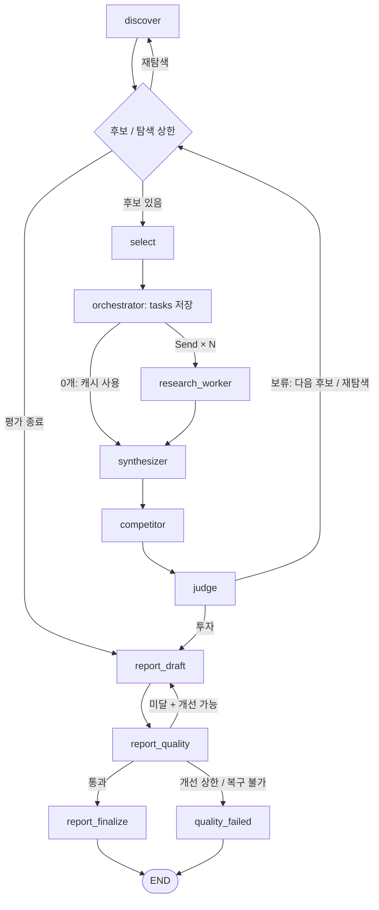

# PLAN — AI 스타트업 투자 평가의 에이전트 패턴 전환

## 1. 목표와 적용 범위

기존 Energy AI 스타트업 투자 평가 RAG에 **LangGraph Orchestrator-Workers 패턴**을 적용한다. 조사 계획에 따라 worker를 동적으로 배분하고 결과를 집계한 뒤, 보고서 품질을 평가하고 미달 시 개선한다.

기준: [Multi-Agent Orchestration 과제](https://actually-war-1ea.notion.site/Multi-Agent-Orchestration-3d57f4c866938020a992fcc97e942ee6)의 실습 목표·Mandatory Items·Deliverables 평가 항목.

- **선택 이유:** 기존 기술·시장 RAG를 작업 단위로 재사용할 수 있고, 병렬 조사와 보고서 집계에 적합하다. 동적 병합·부분 실패 처리가 필요하다는 trade-off를 README에 설명한다.
- **유지:** Energy 도메인, 후보 발굴·다음 후보·전체 보류 경로, 기술 Agentic RAG·시장 Advanced RAG, 오픈소스 임베딩·문서 200쪽 제한, 기존 투자 루브릭과 코드 기반 판정.
- **전환:** `select → 기술·시장 고정 병렬 → competitor`를 `select → 계획 → 동적 workers → synthesizer → competitor`로 바꾼다.
- 필수 요구와 아래의 구현 선택을 구분한다. 규칙 기반 planner, 재시도 1회, 보고서 개선 2회는 이 프로젝트의 설계 선택이다. Supervisor·Swarm·Agent-as-Tool은 추가하지 않는다.

## 2. Deliverables 평가 항목별 구현·완료 기준

| 평가 항목 | 배점 | 구현할 내용 | 완료 증거 |
|---|---:|---|---|
| 패턴 적용 정합성 | 20 | 실행 전 구조화 계획 저장, 계획에 따른 동적 Send, 결과 누적·synthesizer 집계, worker 실패 fallback | 실제 코드·계획·집계·실패 처리 테스트 |
| 동적 동작 실증 | 20 | 입력·캐시·부족 항목에 따라 실행 작업의 수·종류·질의 변경 | 서로 다른 fan-out을 보여 주는 실제 LangSmith trace |
| State Schema 설계 | 20 | 제어/페이로드·관측성·지속성 비용·상관·복구·동시성·종료 설계 | §4 설계가 State·reducer·상한 코드에 반영됨 |
| 품질 평가 노드 | 15 | 보고서 생성 후 Groundedness·중립성·편향 평가, 미달 시 피드백 개선 루프 | fail → 보고서 개선 → 재평가 trace와 테스트 |
| 코드 구조 및 모듈 분리 | 5 | 조정·worker·집계·품질 평가 책임 분리, 기존 RAG 재사용 | 디렉터리와 역할을 README에 설명 |
| 실행 결과 재현성 | 10 | 실제 PDF 생성, 유한 반복·정상 종료, 환경·입력·실행 기록 | 새 환경 실행 확인, 제출 trace와 결과 연결 |
| Output — 보고서 | 10 | 투자 평가 목적에 맞는 본문, 첫 SUMMARY·마지막 REFERENCE, 최대 10쪽 | 실제 PDF의 목차·근거·내용·페이지 확인 |

## 3. Orchestrator-Workers 구현

### 계획 → 배분 → 집계

1. **Orchestrator:** 후보와 기존 근거·시장 캐시의 충족도를 읽어 필요한 조사만 `tasks`에 저장한다.
   - `TaskSpec = {task_id, kind, query, reason, target_fields}`.
   - 작업 종류: 기업 기술·업계 수준·팀·시장 규모·성장·수요·규제.
   - 시장 캐시가 충분하면 해당 작업을 생략하고, 일부 항목만 부족하면 그 항목의 작업만 생성한다. 캐시 존재 여부만으로 충분성을 판단하지 않는다.
2. **Workers:** 저장된 tasks를 읽어 `Send("research_worker", 작업별 입력)`으로 배분한다. 기존 RAG·웹 검색 함수를 사용하고 worker별 최소 문맥만 전달한다.
   - `TaskResult = {task_id, status, findings, source_ids, evidence_ref, attempts, error_code}`.
   - 상태는 성공·근거 부족·실패로 구분한다. worker는 공통 결과 필드에 delta만 반환한다.
3. **Fallback:** 일시적 호출 오류는 최대 1회 재시도 후 실패 결과를 반환하고 다른 worker는 계속한다. 기존 내부 재시도와 중복 적용하지 않는다. 인증·설정 오류는 명시적으로 실행 실패 처리한다.
4. **Synthesizer:** 계획된 모든 작업의 완료·부족·실패 결과를 확인하고 기술·시장 결과를 집계한다. 성공 결과와 유효 캐시를 보존하고, 부족 관점은 기존 fallback 및 정보 부족 표시로 처리한다.
5. **기존 후속 단계:** 집계된 결과로 `competitor → judge`를 실행한다. 투자면 보고서, 보류면 다음 후보·재탐색, 전체 보류 또는 상한이면 보류 보고서로 진행한다.

**필수 주의:** 매번 같은 worker 목록을 Send로 실행하면 고정 fan-out이다. 계획이 실제로 달라져야 한다. 기존 기술·시장 고정 join은 제거하고 집계 노드로 합류한다. tasks가 0개여도 캐시 결과를 집계하도록 명시적으로 synthesizer로 분기한다.

## 4. State Schema 구현

기존 `InvestState`와 분석 필드명을 유지하고 다음 필드를 추가한다.

- 제어: `run_id`, `tasks`, `report_version`, `quality_result`, `execution_status`.
- 페이로드: `worker_results`, `evidence_index_ref`, `report_draft_ref`, `report_preview_ref`.
- 계획·작업 결과·품질 verdict는 Pydantic으로 검증한다. 계획과 결과를 같은 필드에 섞지 않는다.

| 설계 항목 | 구현 방식 |
|---|---|
| 제어 vs 페이로드 | 라우팅·계획·종료 필드와 분석 결과·파일 참조를 주석과 타입으로 구분 |
| 관측성 위치 | 계획·분기·fallback·품질 판단 사유는 외부 로그·LangSmith에 기록; State에는 짧은 요약과 최신 판정만 유지 |
| 지속성 비용 | 검색 원문·청크·전체 로그는 외부 저장; tasks/results는 후보별 초기화, 평가 이력은 최대 8개, 초안은 파일 참조 |
| 상관 | 동일 run_id를 State·출력 디렉터리·로그·LangSmith metadata에 사용 |
| 재개/복구 | 작업 status·attempts·error_code로 부분 실패 복구; 프로세스 종료 시 처음부터 재실행하며 캐시 재사용. 중간 checkpoint 재개는 지원 범위에서 제외한다고 명시 |
| 동시 처리 | worker_results에 task_id 기준 병합 reducer; 초기화는 worker 실행 전 단계에서만 수행. 집계 순서는 worker 완료 순서에 의존하지 않음 |
| 종료 보장 | 기존 탐색 3회·평가 8개·RAG rewrite 2회 유지; 호출 시도 최대 2회, 보고서 개선 최대 2회. 변경 그래프의 최장 경로로 recursion_limit 확인 |

worker는 점수·판정·시장 캐시를 직접 쓰지 않는다. synthesizer가 최종 분석과 캐시·출처의 신규 delta를 반환한다. 기업별 출처 연결을 유지하고 같은 결과 재전달로 중복 누적되지 않도록 병합을 검증한다.

## 5. 보고서 품질 평가와 Loop

기존 `report_writer.build_report()`를 활용해 **초안 생성 → 품질 평가 → 최종 저장**으로 나눈다. 평가는 코드 검사와 LLM Judge를 결합한 Hybrid 방식으로 구현한다.

| 필수 평가 항목 | 평가 내용 |
|---|---|
| Groundedness | 중요한 사실·수치·표의 출처 ID와 실제 근거 발췌를 대조. 인용 없는 주장, 유효 ID지만 원문이 지지하지 않는 주장도 검출 |
| 중립성 | 기술의 무조건적 추천·우열·홍보성 단정 검사. 기존 루브릭의 투자/보류 결론은 유지하되 사실·추론·불확실성을 구분 |
| 편향 통제 | 단일 출처·기업 홍보자료·유리한 근거 편중, 반대 근거·리스크·한계 누락 검사 |

- `QualityVerdict`에 항목별 pass/fail, 사유, 수정 피드백, 평가한 report_version을 저장한다. **세 항목과 필수 구조·판정 검사가 모두 통과**해야 최종 저장한다.
- 미달이면 해당 피드백을 다음 초안 생성에 전달한다. 근거 없는 주장은 삭제하거나 정보 부족으로 표현하고, 근거·리스크·불확실성을 반영한 뒤 다시 평가한다. 단순히 같은 프롬프트를 반복하지 않는다.
- 개선은 최대 2회(최초 포함 평가 최대 3회). 계속 미달하거나 Judge 호출이 복구되지 않으면 검토용 초안·미달 사유를 보존하고 quality_failed로 종료한다. 실패를 통과로 취급하지 않는다.
- Reference 서지만으로는 근거성을 검증할 수 없다. 사용한 발췌문·URL 또는 문서 페이지와 주장 연결을 외부 evidence 파일에 남긴다. 검색한 자료 전체를 실제 활용 출처로 등록하지 않는다.
- 투자·전체 보류·후보 없음 모두 평가한다. 전체 보류 보고서의 이전 기업 근거도 보존한다. 후보 없음은 실행 이력·탐색 한계를 보고하고 외부 사실을 만들어 넣지 않는다.
- 기본 PDF는 기존 5쪽 이내를 유지하여 새 과제의 최대 10쪽 조건도 충족한다. SUMMARY는 1/2쪽 이내, REFERENCE는 실제 활용 자료만 기재한다.
- 분량 축소로 본문을 바꾼 경우 최종 본문을 다시 평가한다. 통과한 동일 revision의 PDF·MD만 확정한다. run_id/version별 파일명으로 반복 생성 충돌을 막는다.

## 6. 변경 파일과 구현 순서

| 순서 | 변경 대상 | 작업 |
|---|---|---|
| 1 | `schemas.py`, `state.py`, `config.py` | TaskSpec/Result/Verdict, 필드·reducer, 시도·개선 상한 정의 |
| 2 | `agents/orchestrator.py`, `agents/research_worker.py`, `agents/synthesizer.py` 신규 | 계획·동적 worker·집계 구현; 기존 tech_summary/market_eval의 검색·집계 로직 분리·재사용 |
| 3 | `graph/builder.py`, `graph/routing.py`, `agents/select_candidate.py` | 고정 분기/join 교체, 후보별 초기화, 기존 후보 라우팅 연결 |
| 4 | `agents/report_writer.py`, `agents/report_quality.py` 신규, 품질·보고서 프롬프트 | 초안/평가/최종 저장 분리, 피드백 루프, 실패 종료 |
| 5 | `tools/references.py`, RAG·분석 모듈, `app.py`, `.env.example` | 실제 사용 근거·기업별 evidence 저장, 실행별 출력·LangSmith 설정. 병렬 검색·로컬 모델의 공유 lock/캐시 안전성 확인 |
| 6 | `tests/`, `README.md`, State 설계 문서 | 평가 항목별 검증, 실제 실행·trace·PDF, 변경된 구조와 문서 일치 |

별도 작업 브랜치에서 구현한다. 기존 투자 판단은 코드가 계속 결정하며, 임베딩·검색 알고리즘·투자 기준을 재설계하지 않는다. 기존 State 설계 문서와 달라진 계획 저장·동적 분기·품질 루프도 문서에 반영한다.

## 7. 검증 및 제출 완료 조건

- [ ] **정합성:** 계획이 worker 실행 전에 저장되고, Send 결과가 누적되어 synthesizer가 한 번 집계된다. 0/N 작업·부분 실패·부족 근거 경로를 테스트한다.
- [ ] **동적 실증:** 시장 cache miss와 유효 cache hit, 일부 항목 부족에서 다른 tasks/fan-out을 확인하고 실제 LangSmith trace를 남긴다.
- [ ] **State:** reducer 동시 쓰기·중복 전달·후보 초기화·run_id 연결·모든 상한을 테스트한다.
- [ ] **품질:** 출처 없는 수치·원문과 모순·기술 우열 표현·출처 편중 fixture가 실패하며, fail→피드백 개선→재평가와 상한 종료를 확인한다.
- [ ] **기존 기능:** 투자·보류·재탐색·전체 보류, 70점 경계·탈락 조건·Reference 처리 회귀 테스트 및 전체 pytest 통과.
- [ ] **재현성:** stub 경로 문자열과 실제 PDF 생성 검증을 구분한다. 실제 LLM·웹 검색으로 실행하고 페이지·한글·표·목차·근거를 확인한다. 모델·프롬프트·문서·검색 cache 정보를 기록한다.
- [ ] **README:** 목적·패턴 선택/trade-off·동적 처리·편향 방지·품질 평가·기술 스택·Agents·State 7항목·그래프 이미지·디렉터리·실행법·Contributors 작성. Contributors는 개인별 수행 역할이며 PM/PL은 제외한다.
- [ ] **제출물 3종:** 별도 브랜치 GitHub 링크 + 실제 LangSmith PNG + 평가 보고서 PDF. 긴 trace는 tracing-1.png, tracing-2.png처럼 순서를 구분한다.
- [ ] **패키지:** `Agent_{캠퍼스}_{X반}_{이름1+이름2+...}.zip`에 Git 링크·PNG·PDF 포함. 과제 안내의 DAY 2 퇴근 전, 반별 Slack thread 제출 조건을 따른다.

완료 기준은 그래프 코드 작성만이 아니라 **7개 평가 항목의 구현과 실제 실행 증거 확보**다. 위 체크박스는 구현 후 확인할 항목이며, 현재 완료됐다는 뜻은 아니다.
