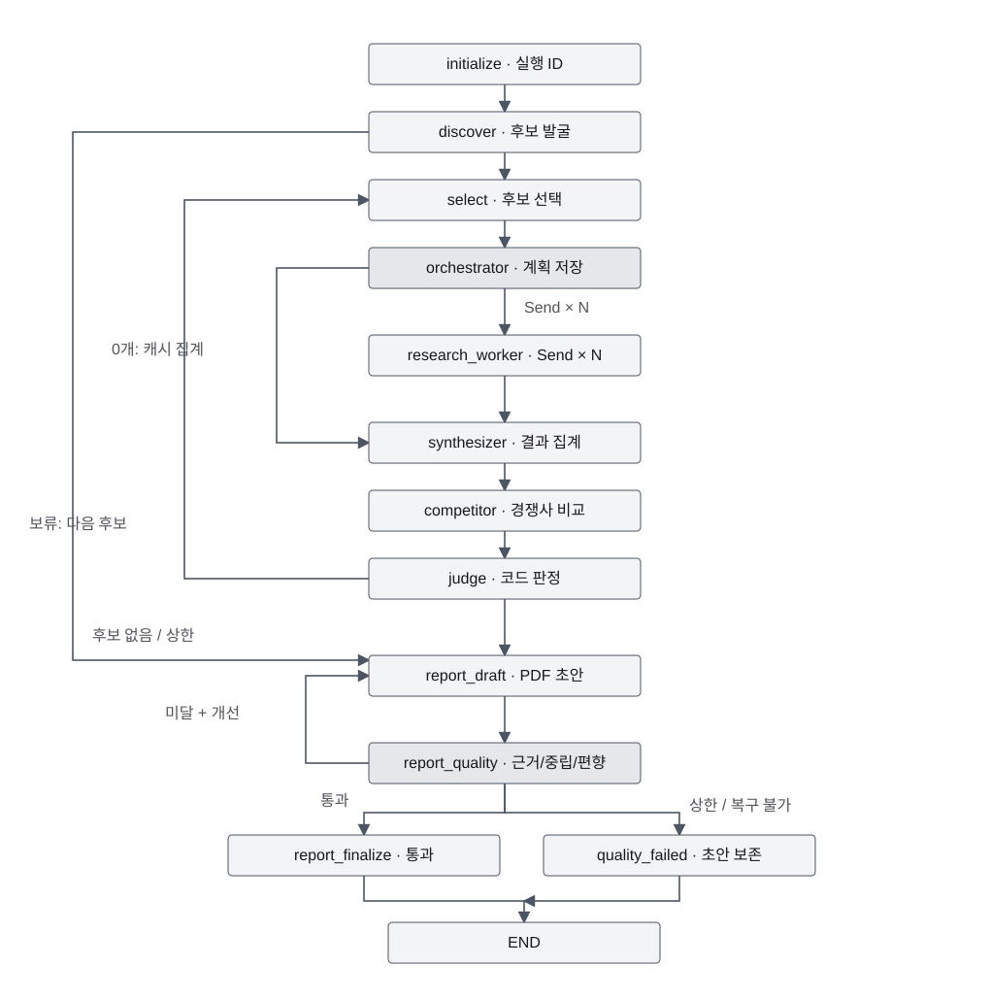
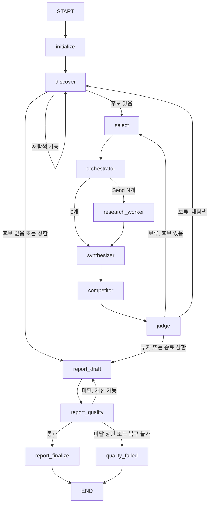

# AI Startup Investment Evaluation Agent

Energy AI 스타트업을 발굴·조사·평가하고 투자 보고서를 생성하는 **LangGraph Orchestrator-Workers** 시스템입니다. 기존 기술 Agentic RAG와 시장 Advanced RAG를 조사 도구로 재사용합니다.

## Overview

- **Objective:** 전력 수요 예측, 발전 예측·VPP, ESS 운영, 전력망 관리 스타트업의 투자 가능성을 공개 근거로 평가합니다.
- **Pattern:** Orchestrator-Workers. 기술·시장·팀 등 조사 관점을 독립 작업으로 나누고 병렬 수집한 결과를 합치기에 적합합니다. 기존 Agentic RAG와 Advanced RAG를 worker의 조사 도구로 재사용합니다.
- **동적 처리:** 규칙 기반 Orchestrator가 현재 후보의 근거·캐시·부족 항목에 따라 `TaskSpec` 목록을 State와 파일에 저장한 뒤 `Send`로 필요한 worker만 생성합니다. 조사 작업은 7개·3개·4개 또는 0개로 달라지며, Synthesizer가 전체 작업 결과를 집계합니다. 보고서 품질 미달은 실패 위치와 피드백에 따라 수정·재평가로 분기합니다.
- **대상:** 비상장, Seed~Series C, M&A·IPO 등 Exit 미완료 기업.
- **판정:** 11개 항목의 가중합 70점 이상, 창업팀·규제 점수가 모두 4점 이상이면 투자. 공개 정보 부족은 5점으로 처리합니다. 합산과 판정은 코드가 담당합니다.
- **산출물:** 품질을 통과한 PDF·Markdown, 실행별 계획·작업 결과·원문 근거·품질 판정·실행 기록.

패턴 변경 계획은 [PLAN.md](PLAN.md), State 설계는 [STATE_DESIGN.md](docs/STATE_DESIGN.md)를 참고하세요. 기존 [RAG 구현 명세](docs/IMPLEMENTATION_PLAN.md)와 [작업 분배](docs/WORK_DIVISION.md)는 이전 실습의 설계 기록입니다. 현재 실행 구조는 이 README와 PLAN을 따릅니다.

테스트·실제 trace·PDF 검증의 결과와 미완료 제출 항목은 [검증 기록](docs/VALIDATION.md)에 구분해 기록했습니다.

## Selected Technologies

평가 대상은 Energy AI 스타트업의 전력 수요 예측, 발전 예측·VPP, ESS 운영 최적화, 전력망 관리 기술입니다. 아래는 이를 조사·평가하는 시스템의 구현 기술과 선정 근거입니다.

| 선정 기술 | 선정 이유 |
|---|---|
| LangGraph Orchestrator-Workers | State에 저장한 계획에 따라 `Send`로 작업 수를 바꾸고, reducer로 병렬 결과를 병합하며 조건부 라우팅으로 평가·수정 루프를 제어합니다. |
| 기술 조사용 Agentic RAG | 기업 기술·업계 수준을 문서에서 검색하고, 근거가 부족하면 질의를 재작성하거나 웹 검색으로 보완하는 기존 조사 흐름을 재사용합니다. |
| 시장 조사용 Advanced RAG | 시장 규모·성장·수요·규제 자료를 Kiwi BM25와 Dense 검색으로 찾고 RRF·리랭킹을 적용합니다. 키워드와 의미 검색 결과를 함께 활용합니다. |
| 오픈소스 `BAAI/bge-m3` | 동일 청크·질문의 검색 평가에서 기술 Hit Rate@5 0.8000·MRR 0.6267, 시장 Hit Rate@5 0.8000·MRR 0.6122를 기록했습니다. 비교한 BGE·Qwen·E5 중 두 관점의 검색 성능을 함께 고려해 선택했습니다. [평가 결과](outputs/embedding_eval.md) |
| Chroma | 기술·시장 문서 컬렉션을 구분하고 문서 ID·페이지를 검색 결과에 연결하는 기존 벡터스토어를 재사용합니다. |
| Hybrid 품질 평가 | 인용·수치·확정 점수·PDF 분량은 코드로 검사하고, 주장과 발췌의 의미·중립성·편향은 독립 LLM Judge로 검사합니다. 실패한 코드 검사는 Judge가 덮어쓸 수 없습니다. |

## Features

- 웹 발굴 또는 시드 후보 로드, 보류 시 다음 후보·재탐색, 전체 보류·후보 없음 보고서.
- 후보별 구조화 계획을 **worker 실행 전에** 파일과 State에 저장합니다.
- 캐시의 국가·세그먼트·항목별 내용·실제 원문 근거를 확인합니다. 정보 부족인 관점만 재조사합니다.
- 초기 조사 7개, 충분한 시장 캐시가 있으면 기술·업계·팀 3개, 성장 정보만 부족하면 4개로 작업이 달라집니다. 유효한 기술·시장 캐시가 모두 있으면 worker 없이 집계합니다.
- worker는 작은 전용 입력만 받고 task_id별 결과 delta를 반환합니다. 실패한 worker가 있어도 성공 결과와 유효 캐시를 집계합니다.
- 일시적 worker 호출 실패는 최대 1회 재시도합니다. RAG 내부 호출과 worker 재시도를 중첩하지 않습니다. 인증·설정 오류는 실행 실패로 전달합니다.
- Groundedness·중립성·편향 통제와 구조·점수·분량 검사를 모두 통과해야 최종 보고서를 저장합니다.
- 확증 편향 방지: 특정 기업의 근거를 다른 기업에 적용하는지, 유리한 근거만으로 결론을 확정하는지, 기업 홍보자료·단일 출처 의존의 한계를 숨기는지 검사합니다. 단일 출처는 한계를 공개하고 결론을 유보하면 허용하며, 출처 개수만으로 통과시키지 않습니다.
- 미달 피드백을 다음 본문·SUMMARY 생성에 전달합니다. 최초 포함 최대 3개 버전을 평가하며, 끝까지 미달하거나 Judge가 실패하면 `quality_failed`로 종료합니다.
- 문서 발췌·원본 페이지·웹 URL·기업·출처 ID를 실행별 파일로 보존합니다. 서지 정보만으로 근거성을 판단하지 않습니다.
- 실제 PDF의 분량 조정 후 품질을 평가하고, 통과한 같은 버전의 PDF·본문 해시를 확인해 그대로 확정합니다. 최신 과제 지침에 따라 최대 10쪽, 첫 SUMMARY는 반 페이지 이내, 마지막은 REFERENCE입니다.

보고서 품질 평가의 세 항목은 다음과 같습니다.

| 최소 평가 항목 | 적용 기준 |
|---|---|
| Groundedness | 중요한 외부 사실을 인용 source_id와 원문 발췌에 연결해 대조합니다. 기업·지표·기간·통화·맥락 불일치를 거부하며, `$20 million`과 `2000만 달러` 같은 정확한 동치 표현은 허용합니다. 코드가 산출한 점수·판정은 State의 확정 결과와 비교합니다. |
| 중립성 | 특정 기술의 선택 추천·우열 판정·홍보성 단정을 거부합니다. 투자 루브릭에 따른 기업의 투자·보류 판정과 근거 있는 평가·추론은 구분해 허용합니다. |
| 편향 통제 | 유리한 근거만으로 결론을 확정하는 표현과 단일 출처·홍보자료 의존의 한계 은폐를 거부합니다. 정보 부족·독립 검증 한계를 공개하고 결론을 유보할 수 있습니다. |

## 과제 필수 조건 구현 및 검증

| 과제 조건 | 구현·검증 근거 |
|---|---|
| 계획 수립 후 Dynamic Fan-out | [orchestrator](agents/orchestrator.py)가 구조화된 작업 목록을 State·파일에 저장하고 [assign_workers](graph/routing.py)가 목록에 따라 `Send`를 생성합니다. 작업 수 7·3·4·0개 분기를 [테스트](tests/test_orchestration.py)로 검증합니다. |
| Worker 결과 누적·Synthesizer 집계 | [State reducer](state.py)가 task_id별 결과를 병합하고 [synthesizer](agents/synthesizer.py)가 계획한 모든 결과를 검증·집계합니다. 충돌 거부·중복 전달·실제 Send/join 동작을 테스트합니다. |
| 일부 Worker 실패 시 fallback | [research_worker](agents/research_worker.py)가 일시 오류를 최대 1회 재시도합니다. 집계 단계는 실패한 작업을 제외하고 성공한 근거·유효 캐시를 보존하며 부족 항목을 표시합니다. 인증·설정 오류는 실행 실패로 처리합니다. |
| State Schema 7개 설계 항목 | 아래 State Schema에 제어/페이로드·관측성·지속성 비용·상관·재개/복구·동시 처리·종료 보장을 명시합니다. 중간 checkpoint 재개는 지원하지 않으며, 실패 상태와 재시도·새 실행 시 캐시 재사용을 제공합니다. |
| 생성 후 품질 평가·미달 Loop | [그래프](graph/builder.py)가 `report_draft → report_quality`를 연결합니다. 세 품질 항목과 구조 검사를 모두 통과하면 확정하고, 복구 가능한 미달은 최대 2회 수정·재평가하며 종료 조건에 도달하면 `quality_failed`로 끝냅니다. |
| 보고서 분량·구성 | 실제 PDF는 REFERENCE 포함 최대 10쪽이고 첫 SUMMARY는 반 페이지 이내입니다. 장별 글자 수는 작성 안내이며 품질 탈락 기준으로 사용하지 않습니다. |

전체 자동 테스트는 **297개 통과**했습니다. [최근 실제 보고서 구간 E2E](outputs/runs/report-flow-e2e-5129c0fb06e4/e2e_summary.json)는 실제 생성기·Judge(`gpt-4o-mini`)로 v1 품질 평가·PDF 확정과 **11/11 검증 조건 통과**를 확인했습니다. 기존 해줌 조사 결과를 재사용한 보고서 구간 실행입니다. 실행 산출물은 gitignore 대상이며, 상세 범위·한계와 이전 전체 그래프 실행 기록은 [검증 기록](docs/VALIDATION.md)에 있습니다. 사용자의 전체 실행 `b0a8c7d6874440c98a669596e47110e6`에 해당하는 [실제 LangSmith 캡처 6장](docs/langsmith/b0a8c7d6874440c98a669596e47110e6/README.md)을 보존했습니다. 조사 작업 수 7·7·3·7개와 v1 품질 통과·PDF 확정을 확인할 수 있습니다. 제출 ZIP 구성·업로드는 미완료 제출 항목입니다.

**패턴 선택과 trade-off:** 기술·시장 조사 도구를 작업 단위로 분리하기에 Orchestrator-Workers가 적합합니다. 캐시·부족 정보에 따라 실행 작업이 달라지며, Supervisor·Swarm·Agent-as-Tool을 추가하지 않습니다. 동적 결과 병합·부분 실패·근거 연결을 관리해야 하고, 품질 Judge와 개선 루프에 추가 호출 비용이 발생합니다. 로컬 모델의 안전성을 위해 임베딩·리랭커 실행은 공유 락으로 직렬화합니다.

## Tech Stack

| 영역 | 구현 |
|---|---|
| Language | Python 3.11 |
| Framework | LangGraph StateGraph, Send, Overwrite, 조건부 라우팅 |
| Generation / Judge | ChatOpenAI, `.env`의 LLM_MODEL / JUDGE_MODEL, temperature=0 |
| Structured Output | Pydantic v2 TaskSpec·TaskResult·QualityVerdict |
| Web | Tavily, 원자적 검색 캐시 저장 |
| PDF / Vector Store | pypdf, Chroma tech_docs / market_docs |
| Embedding | 오픈소스 BAAI/bge-m3, local / hf_api |
| Market Retrieval | Kiwi BM25 + Dense + RRF + bge-reranker-v2-m3 + 문장 압축 |
| Report | fpdf2, SUIT 정적 TTF, PDF·Markdown 공용 모델 |
| Observability | 표준 logging, 실행별 JSON, LangSmith tracing |
| Test | pytest, 외부 서비스 mock + 실제 LangGraph/PDF |

기술·시장 문서 6종의 발췌본은 195쪽입니다. 인제스트는 200쪽을 넘으면 중단합니다. 기존 임베딩 비교는 BGE·Qwen3·E5를 동일 청크·질의로 평가하며 Hit Rate@5와 MRR를 [평가 결과](outputs/embedding_eval.md)에 기록합니다.

## Agents

| 노드 | 책임 |
|---|---|
| discover | 웹 후보 추출·요건 검증·유망도 정렬, 시드 fallback |
| select | 후보 선택과 후보별 분석·작업 결과 초기화 |
| orchestrator | 필요한 관점만 TaskSpec으로 계획하고 저장 |
| research_worker | 기업 기술·업계·팀·시장 규모·성장·수요·규제 중 한 작업 수행 |
| synthesizer | 모든 계획 결과 검증, 기술·시장 구조화, 유효 캐시·성공 근거 보존 |
| competitor | 경쟁사 비교·진입장벽·대상 기업 Traction |
| judge | 11개 점수 생성, 코드의 가중합·필수 탈락·판정 |
| report_draft | 피드백 반영 본문·SUMMARY, 분량 조정 후 검토용 PDF 생성 |
| report_quality | 원문 대조 LLM Judge + 코드 검사 |
| report_finalize | 통과한 동일 버전의 PDF·Markdown 저장 |
| quality_failed | 최종 보고서 없이 초안·미달 사유 보존 후 종료 |

기존 `tech_summary.synthesize`와 `market_eval.synthesize`는 집계 단계에서 사용합니다. 개별 `run` 함수도 단독 분석 호환성을 위해 보존합니다.

## State Schema

| 설계 항목 | 구현 |
|---|---|
| 제어 vs 페이로드 | run_id·tasks·report_version·quality_result·execution_status / 분석 결과·worker_results·파일 참조 분리 |
| 관측성 위치 | 계획·결과·품질 사유는 파일과 LangSmith, State.log에는 짧은 주요 이력 |
| 지속성 비용 | 원문·청크·초안은 파일에 저장, task/result는 후보마다 초기화, 평가 이력 최대 8개 |
| 상관 | 동일 run_id를 디렉터리·manifest·로그·LangSmith metadata에 사용 |
| 복구 | worker status·attempts·error_code, 부분 실패 보존. 중간 checkpoint 재개는 지원하지 않으며 프로세스 종료 후 새 실행과 검색 캐시 재사용 |
| 동시성 | task_id 기준 정렬·멱등 병합, 충돌 거부. select가 Overwrite로 결과 초기화. worker는 분석·점수·캐시를 쓰지 않음 |
| 종료 | 탐색 총 3회, 후보 최대 8개, RAG rewrite 2회, 호출 최대 2회, 보고서 개선 2회, recursion_limit=100 |

## Architecture





실제 실행 그래프의 Mermaid도 각 실행 디렉터리의 `graph.mmd`에 저장됩니다.

## Directory Structure

```text
app.py / config.py / schemas.py / state.py
agents/         # 계획·worker·집계·분석·판정·보고서·품질
rag/            # 기존 Agentic / Advanced RAG·인제스트·임베딩
report/         # 공용 본문 모델·PDF·Markdown
prompts/        # 분석·보고서·독립 품질 평가
config/         # docs.yaml·rubric.yaml
tools/         # LLM·웹·출처·근거 캡처·원자적 artifact·오류 분류
data/          # 6개 PDF·시드·평가셋·벡터스토어
docs/          # State 설계·그래프·이전 실습 기록
outputs/runs/  # run_id별 검토·최종 산출물 (gitignore)
tests/         # 회귀·동적 Send·부분 실패·품질 루프·PDF
```

## Usage

```bash
python -m venv .venv
source .venv/bin/activate  # Windows: .venv\Scripts\Activate.ps1
pip install -r requirements.txt
cp .env.example .env
# OPENAI_API_KEY, TAVILY_API_KEY, LLM_MODEL, JUDGE_MODEL 설정
python -m rag.ingest
python app.py --seed-only
```

- 기본 `python app.py`는 웹 발굴을 사용합니다. `--seed-only`도 기업 조사·채점·품질 평가의 실제 LLM 호출과 웹 검색을 사용합니다.
- `--no-cache`로 웹 검색 캐시를 무시합니다. `--stub`은 동적 그래프의 모의 라우팅이며 PDF 생성·실제 품질 검증 증거가 아닙니다.
- `LANGSMITH_API_KEY`, `LANGSMITH_TRACING=true`, `LANGSMITH_PROJECT=energy-orchestrator-workers`로 tracing을 설정합니다. 추적은 run_id와 연결됩니다. false면 추적을 끕니다.
- hf_api 임베딩은 HF_TOKEN이 필요합니다. 문서를 바꾸면 `python -m rag.ingest --rebuild`로 갱신합니다.
- 품질 미달은 종료 코드 1이며, 초안과 품질 판정에서 수정 사유를 확인합니다. 판정 기준을 낮춰 통과시키지 않습니다.

각 `outputs/runs/{run_id}/`에는 다음 파일이 저장됩니다.

| 파일 | 내용 |
|---|---|
| manifest.json / graph.mmd | 모델·입력 hash·캐시 여부·run_id / 실행 그래프 |
| plans/*.json | 기업별 저장된 조사 계획 |
| workers/*.json / analyses/*.json | 작업별 근거·결과 / 후보 집계 |
| evidence/*.json / evidence_index.json | 실제 출처의 웹 본문·문서 발췌·기업·원본 페이지 |
| draft_vN.json / preview_vN.pdf / preview_vN.md | 검토할 같은 버전의 전체 보고서 |
| quality_vN.json | 항목별 pass/fail·이유·수정 피드백 |
| report_vN.pdf / report_vN.md | 모든 품질 검사를 통과한 최종 산출물 |
| run_log.json / failure.json | 정상·품질 실패의 최종 State / 실행 예외의 안전한 오류 유형 |

```bash
pytest -q
python -m rag.ingest --check-only
python -m eval.embedding_eval --validate-only
```

웹 동명 기업 필터는 도메인·기업명·전력 산업 용어를 사용합니다. 동명 기업 혼입이나 공개 자료의 부족이 완전히 제거되는 것은 아니며, 품질 평가에서 원문과 기업 연결을 추가 검토합니다.

## Contributors

기존 RAG 실습의 개인별 담당 역할:

- **제유진:** 공통 스키마·State, 그래프·라우팅, 탐색, 실행·통합.
- **윤서정:** 인제스트·오픈소스 임베딩·Advanced RAG·시장성·임베딩 평가.
- **장주호:** Agentic RAG·기술 요약·경쟁사 비교·기술 평가셋.
- **이상윤:** 투자 루브릭·채점·보고서·PDF·REFERENCE.

현재 패턴 전환에서는 계획·동적 배분·집계, 근거 파일 연결, 품질 평가·개선 루프, 실행별 관측성과 검증을 추가했습니다.
